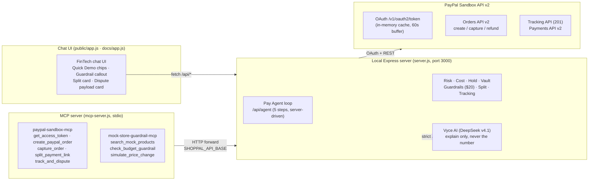

# ShopPal v2 - The safe PayPal shopping agent

> **AI shopping agent that scores sellers, shows the real PayPal total before you pay, and auto-saves proof for disputes.**
>
> **PayPal AI Hackathon - Best Use of Agentic Commerce ($5,000)**
> Deadline: Friday, 13 November 2026, 04:00 WITA (12 November 2026, 12:00 PT)

**Live demo:** https://fhria5.github.io/shoppal-v2/ (static) · https://fhria5.github.io/shoppal-v2/live/ (live server)
**Video:** see `video/shoppal-v2-demo.mp4` (72 s, vertical) - upload to YouTube and paste the link into Devpost.

> **Sandbox only. No real money.** Every payment uses the PayPal Sandbox with sandbox buyer / seller test accounts. No live PayPal account, no real funds, and no real credentials are committed.

## The problem: three ways shopping agents hurt people

Most shopping agents only buy things. That is exactly the danger. ShopPal v2 is built around the three failures that make an autonomous buyer unsafe - and each one is a feature, not a slogan.

### 1. Rogue AI Agent Safety - an agent that pays without asking

An agent that can spend your money must never do it silently. ShopPal enforces **Smart Guardrails** server-side, never by the model:

- **Auto-approve limit $20.** Any purchase whose honest total (item + PayPal fees) is at or below $20 goes through on its own. Above $20 the agent **stops, creates the order, and waits** - the UI shows **"Pending Human Approval (Guardrail Triggered)"** with an amber callout, the reason, and Approve / Reject buttons.
- The agent **never calls capture**. The buyer always approves the payment on PayPal's own site. The model only prepares the order and hands over the link.
- The model cannot override the guardrail: `create_order` re-runs the guardrail check on the server before it creates anything, even if the model says otherwise.

### 2. Social Split Checkout - splitting a bill should not need a new app

Friends split purchases all the time; PayPal's Invoicing API (the obvious tool for it) returns **403 NOT_AUTHORIZED** for this sandbox app, and the Payouts API 404s. So ShopPal splits the bill a different way - see [How we beat the 403](#how-we-beat-the-403-invoicing-api) below.

### 3. Post-Purchase Dispute - when the parcel never arrives, the proof is gone

PayPal's own data shows the top complaint is holds and disputes with no evidence. ShopPal saves a **Proof Vault** entry automatically on every verified capture (order, capture ID, risk score, cost breakdown, timeline), predicts the **hold risk**, and can **track the parcel** (real PayPal Tracking API, HTTP 201) and **simulate a dispute** whose payload follows the official PayPal Disputes API shape (`dispute_id`, `reason: MERCHANDISE_OR_SERVICE_NOT_RECEIVED`, `status: OPEN`, `dispute_life_cycle_stage: INQUIRY`) - labelled as a simulation, because no real ticket is opened.

## What ShopPal does

1. **AI Seller Risk Score (0–100)**, before you pay, every seller is scored with auditable, rule-based weights and explained in plain language. Safe 80–100 · Caution 50–79 · Risky 0–49.
2. **AI Total Cost**, before checkout starts, you see the full estimated cost: item price, PayPal Checkout fee, international fee, and currency conversion spread. No surprise total after checkout starts.
3. **Pay Agent** - a server-driven agent loop (`POST /api/agent`, max 5 steps) that searches, scores, checks guardrails and prepares the order. Vyce (DeepSeek v4.1) decides the next action as strict JSON; a rule-based fallback does the same when AI is absent. **Vyce does not support native function calling** (tested twice), so the loop is server-driven, not tool-calling.
4. **Price Watch (sniper)** - set a target price; the agent watches the (labelled, simulated) price feed and buys the moment it drops to the target.
5. **Split Payment Link** - split a purchase with friends; each friend gets their own PayPal Sandbox order + payment link for their share.
6. **AI Proof Vault** - after a successful PayPal capture, a snapshot of the product, seller score, cost breakdown, and PayPal order / capture IDs is saved automatically.
7. **Hold Predictor + Hold Release Checklist** - hold risk (Low/Moderate/High) and the exact steps that release a hold early.
8. **Dispute Win Simulator + One-Click Evidence Pack + Deadline Tracker** - win-chance estimate, a printable proof page, and the 180-day filing / 20-day escalation / 30-day return deadlines.
9. **Check Any Link + PayPal Phishing Check + Import Cost + FX Optimizer + Expense Dashboard + Monthly Budget + Subscription Watcher** - paste any product URL to check it, paste a suspicious PayPal message to score it, estimate import duty/VAT, compare the PayPal FX markup (3.5%) against the live mid-market rate, and see spending by category.

**The agent never pays without your explicit approval.** That is responsible Agentic Commerce, and it is a deliberate design choice.

## Demo flow (7 steps)

1. Ask for a product (for example, "headphones under $60 for a gift") or pick one from the demo catalog - or tap a **Quick Demo** chip above the chat input (cheap item, headphone p01, split with Budi & Sari, track & dispute).
2. See the Risk Score for each seller option. A risky option is shown in red with reasons, never hidden.
3. Pick a product and see the full Total Cost breakdown, plus a Hold Predictor warning when relevant.
4. Check out with PayPal Sandbox: the server creates an order via Orders API v2, you approve as a sandbox buyer, then the server captures it.
5. See the success screen: order ID, `COMPLETED` status, and the exact same total as in step 3.
6. Open the Proof Vault: the transaction snapshot is saved automatically.
7. Simulate a dispute: AI drafts a response from the Proof Vault evidence, with a proof-readiness score and a list of anything still missing.

## Architecture



The static demo (`docs/`, GitHub Pages) mirrors the server's formulas in the browser (rule-based only, no secret, vault in localStorage). The live demo (`docs/live/`) talks to the real server on Cloudflare Workers. The MCP server is a **thin wrapper**: every tool call is forwarded to the running ShopPal server over HTTP, so the web app's E2E flow is untouched.

```
ShopPal v2 (single repo)
├── public/            Live-server frontend source (index.html, app.js, styles.css)
├── docs/              Static demo (GitHub Pages) + docs/live/ (generated live frontend)
├── server.js          Express server: catalog, Risk Score, Total Cost, PayPal
│                      Orders / Capture / Refund, Proof Vault, Pay Agent,
│                      Price Watch, Split, Tracking, Health.
├── mcp-server.js      MCP wrapper (stdio, @modelcontextprotocol/sdk, 8 tools).
├── worker.js          Cloudflare Workers build of server.js (generated).
├── data/catalog.json  Demo catalog: 11 products, 3 sellers with distinct
│                      risk profiles (Safe / Caution / Risky).
├── marketplace/       One adapter per marketplace (eBay first, Browse API).
├── test_new_features2.js  Core test suite (107 checks).
└── test_mcp.js        MCP test suite (17 checks).
```

## How we beat the 403 Invoicing API

The PayPal **Invoicing API returns 403 NOT_AUTHORIZED** for this sandbox app (verified live with a sandbox OAuth token), and the Payouts API 404s. The Transaction Search API is 403 too, so the Expense Dashboard reads the Proof Vault instead. Rather than giving up on split bills, ShopPal uses the API that *does* work - **Orders API v2**:

1. The user asks to split a purchase (e.g. p01, $59.99, with Budi and Sari).
2. The server computes each person's share in **integer cents** (`Math.round(total * 100)`): $59.99 / 3 = **$20.00 per friend**. The initiator's own share absorbs the leftover cents (`initiatorShare: "19.99"`, so 2 × $20.00 + $19.99 = $59.99 exactly).
3. For each friend it creates a **separate PayPal Sandbox order** for exactly their share (`POST /api/split-payment-link` → `createSplitPaymentOrder`, `reference_id: split-…`, no catalog total validation, because a share is not a product price) and returns that friend's `approveUrl`.
4. Each friend pays their own order on PayPal's site. No money-request API is involved, and no capture happens until each friend approves.

The same trick powers the agent's `split_payment_link` tool and the MCP `split_payment_link` tool. `create_sandbox_invoice` is deliberately **not** exposed anywhere.

## Disputes: real tracking, simulated ticket

- **Tracking is real.** `POST /api/tracking/add` calls the PayPal Tracking API (`POST /v1/shipping/trackers`, `trackers` array body) and returns **HTTP 201**; the tracker ID is `{transactionId}-{trackingNumber}`. The Delivery Watch flags orders that are not `DELIVERED` after 7 days.
- **The dispute ticket is a simulation.** `POST /api/dispute/simulate` (and the agent's `track_and_dispute` tool) returns a `disputePayload` that follows the official PayPal Disputes API shape for `GET /v1/customer/disputes/{dispute_id}`: `dispute_id` (`PP-D-…`), `reason` (`MERCHANDISE_OR_SERVICE_NOT_RECEIVED`, `…_NOT_AS_DESCRIBED`, `UNAUTHORIZED_TRANSACTION`), `status: OPEN`, `dispute_life_cycle_stage: INQUIRY`, `dispute_amount`, `disputed_transactions` (buyer/seller transaction IDs = the capture ID), `seller`, `messages: []`, `outcome: null`. The UI labels it **simulated** and shows it in a dark code block with a Copy JSON button - no real Disputes API ticket is opened, because the sandbox app has no live dispute to file.

## Quick Start

```bash
# 1. Install dependencies (Node.js >= 20)
npm install

# 2. Copy the environment template and fill in your own sandbox values
cp .env.example .env

# 3. Start the main server (http://localhost:3000)
npm start

# 4. Check health (guardrail limit, PayPal Sandbox readiness, MCP tools)
curl http://localhost:3000/api/health

# 5. Run the MCP server (in a second terminal; the ShopPal server must run first)
SHOPPAL_API_BASE=http://localhost:3000 node mcp-server.js

# 6. Run the test suites (core 107 + MCP 17, all must pass)
node test_new_features2.js
node test_mcp.js
```

Open http://localhost:3000 and tap a **Quick Demo** chip above the chat input:
- 🛒 **Beli Barang Murah (< $20)** - buys the cheapest item (p11, $14.99, total $16.74) and auto-checks out below the $20 guardrail.
- 🛡️ **Beli Headphone p01 ($59.99)** - total $65.57, triggers "Pending Human Approval (Guardrail Triggered)".
- 🤝 **Patungan p01 sama Budi & Sari** - split $59.99 three ways, $20.00 per friend, each with their own PayPal payment link.
- 📦 **Lacak & Dispute Pesanan** - tracks the latest purchase (real Tracking API) and shows the dispute payload.

## Required environment variables

See `.env.example`. Never commit a real `.env` file.

| Variable | Description |
|---|---|
| `PAYPAL_CLIENT_ID` | Client ID of your PayPal Sandbox app (public identifier, safe for the JS SDK). |
| `PAYPAL_CLIENT_SECRET` | Secret of your PayPal Sandbox app. Server only. Never log it, never commit it. |
| `PAYPAL_MODE` | `sandbox` (always, for this hackathon). |
| `PAYPAL_API_BASE` | `https://api-m.sandbox.paypal.com` |
| `VYCE_API_KEY` | Vyce API key for AI explanations. Server only, never log it, never commit it, never put it in the static demo. Optional: the rule-based Risk Score and Total Cost work without it. |
| `VYCE_API_BASE` | Vyce API base URL (default `https://vyceai.com/v1`). |
| `VYCE_MODEL` | Vyce model for explanations (default `deepseek-v4.1`). |
| `EBAY_APP_ID` | eBay Developers App ID for real marketplace search. Free at developer.ebay.com. Optional: without it, marketplace search answers "not configured" and the demo uses the catalog. |
| `EBAY_CERT_ID` | eBay Developers Cert ID (the App ID's secret). Server only, never log it, never commit it. |
| `EBAY_API_BASE` | eBay API base URL (default `https://api.ebay.com`). |
| `EBAY_MARKETPLACE` | eBay marketplace site (default `EBAY_US`). |
| `PORT` | Port for the local server (default `3000`). |

## MCP server

`mcp-server.js` exposes the same tools as a real MCP server over stdio (Model Context Protocol, `@modelcontextprotocol/sdk`). It is a thin wrapper: every tool call is forwarded to the running ShopPal server over HTTP, so the web app's E2E flow is untouched. If the ShopPal server is not running, tool calls fail fast with a clear message ("ShopPal server is not running … Start it first with `node server.js`").

```bash
# 1. Start the ShopPal server first (see above), then:
SHOPPAL_API_BASE=http://localhost:3000 node mcp-server.js
# Test it: node test_mcp.js
```

Tools - `paypal-sandbox-mcp`: `get_access_token` (status only, never the token value), `create_paypal_order`, `capture_order`, `split_payment_link`, `track_and_dispute`. `mock-store-guardrail-mcp`: `search_mock_products`, `check_budget_guardrail`, `simulate_price_change`. `create_sandbox_invoice` is deliberately not exposed: the PayPal Invoicing API returns 403 for this sandbox app, and `split_payment_link` (Orders API v2) is the replacement. The dispute in `track_and_dispute` is a simulation; its payload follows the official PayPal Disputes API shape and is labelled simulated.

## Real marketplace search (eBay)

The demo catalog is 11 fake products, good for the judged demo, but a shopping agent should search real marketplaces. ShopPal does that through one adapter file per marketplace (`marketplace/<name>.js`), all returning the same normalized listing shape. eBay is first because its Browse API is open to any free developer account:

1. Create a free account at [developer.ebay.com](https://developer.ebay.com/) and make an app (Sandbox or Production, Sandbox is enough to test).
2. Copy the app's **App ID** and **Cert ID** into your local `.env` as `EBAY_APP_ID` and `EBAY_CERT_ID`.
3. Restart the server and ask ShopPal anything, real eBay listings appear below the demo catalog, each with a real photo, the seller's feedback %, a ShopPal risk score built from marketplace signals (feedback, price vs this search's median, returns and shipping), and a link to the listing.
4. Picking a real listing runs the same 7 steps. Checkout is a **PayPal Sandbox simulation**: it creates a sandbox order for the listing total and saves the proof, it does **not** buy the eBay item, and the UI says so.

Other marketplaces need their own keys and adapters, one at a time: Amazon (Product Advertising API, needs affiliate approval), AliExpress (affiliate app), Shopee / Tokopedia (partner access). There is no single key that unlocks every marketplace, and scraping them is against their terms, so ShopPal only searches marketplaces through their official APIs.

## Create your own PayPal Sandbox buyer / seller accounts

No credentials are included in this repo. Create your own test accounts:

1. Go to [developer.paypal.com](https://developer.paypal.com/) and sign in with your PayPal developer account (create a free one if needed).
2. Open **Apps & Credentials → Sandbox** and create a Sandbox app (or use the default app). Copy its **Client ID** and **Secret** into your local `.env` only.
3. Open **Sandbox → Accounts** and create two sandbox test accounts if they do not exist yet:
   - One **Business (Merchant)** account, the demo seller.
   - One **Personal (Buyer)** account, the demo buyer.
   PayPal generates test email addresses and passwords for these accounts. Use only those sandbox test credentials to approve a payment in the demo.
4. Never use a real PayPal account, real email, or real password in this project, and never paste sandbox secrets into the repo, chat logs, or screenshots.

## How the AI works

Scores are calculated by transparent, auditable rules, the model never invents the number. AI has three bounded jobs only:

1. **Explain the score**, turn the score components into 3 short reasons and 1 recommendation. It must not change the score.
2. **Summarize the cost**, explain in 2 sentences why the final total differs from the item price.
3. **Draft a dispute response**, write a polite, factual reply using only the Proof Vault contents, without adding new facts.

If the AI is unavailable, the rule-based score and cost breakdown are still shown, labelled "AI explanation unavailable".

The other modules are rule-based and labelled as estimates, not AI judgements: the **Hold Predictor** scores hold risk from dispute rate, account age, transaction count, price deviation and tracking; the **Subscription Watcher** flags a product bought twice or more from the Proof Vault; the **trouble-costs strip** lists public PayPal figures the cost table doesn't show (chargeback $20, dispute $15/$30, refund keeps the fee, instant transfer 1.5%, micropayments 4.99% + $0.09 under $12) plus Buyer Protection coverage.

### Risk Score formula (0–100, higher = safer)

| Component | Weight | Rule (summary) |
|---|---|---|
| Profile age & completeness | 25 | Account over 2 years + complete profile scores full. New, incomplete accounts score low. |
| Transaction & dispute history | 35 | Dispute rate under 1% scores full. Over 5% scores near zero. |
| Price fairness vs. median | 20 | Price within 20% of the category median scores full. 50% below the median scores near zero (a common scam pattern). |
| Tracking & return policy | 20 | Tracking + written returns scores full. Neither scores low. |

Zones: **80–100 Safe** (proceed) · **50–79 Caution** (check reasons, use Goods & Services) · **0–49 Risky** (consider an alternative seller).

### Total Cost formula (open, estimated)

For a cross-border purchase, using the public rates from the project research:

| Component | Formula | Example, $50 item |
|---|---|---|
| Item price |, | $50.00 |
| PayPal Checkout fee | 3.49% + $0.49 | $2.24 |
| International fee | 1.50% | $0.75 |
| Currency conversion spread | ~3.5% (shown as an estimate) | $1.75 |
| **Total** | **price + all fees** | **~$54.74–$54.99** |

Every line in the UI is labelled "estimated". These are public fee figures used for transparency in the demo, not a quote from PayPal for every account type. What matters is that no fee appears after checkout starts.

## API

| Method & path | Description |
|---|---|
| `GET /api/health` | Health check: server status, guardrail limit ($20), PayPal Sandbox readiness (`configured` / `tokenCached`), MCP tool count (8). Never calls PayPal. |
| `GET /api/config` | Returns the PayPal client ID (public) and mode. Never returns secrets. |
| `GET /api/catalog` | Demo catalog (sellers + products). |
| `POST /api/risk-score` | `{ sellerId, productId }` → score, label, components, 3 reasons, recommendation, comparison, scam-pattern warning, before-you-pay checklist. |
| `POST /api/hold-risk` | `{ sellerId, productId }` → hold-risk score, label (Low/Moderate/High), estimated chance, reasons, tip. |
| `GET /api/ask?q=` | Plain-language search (English or Indonesian: category, budget or range, cheapest/best/safest, seller, returns/tracking) → products sorted by the ranking asked for. Follow-ups ("yang termurah", "yang pertama") refer to the last results via `&context=`. With `VYCE_API_KEY` set, the intent is parsed by AI (Vyce/DeepSeek) with the regex parser as fallback; `aiParsed` says which one ran. |
| `POST /api/agent` | Pay Agent: server-driven loop (max 5 steps), tools `search_products`, `get_risk_score`, `get_total_cost`, `get_hold_risk`, `check_guardrails`, `create_order`, `get_vault`, `simulate_dispute`, `price_watch`, `check_price_watch`, `list_price_watches`, `split_payment_link`, `track_and_dispute`. Guardrails enforced server-side; the agent never captures. |
| `GET /api/subscriptions` | Recurring purchases found in the Proof Vault (same product bought 2+ times). |
| `POST /api/total-cost` | `{ priceUSD, international, currencyConversion }` → fee breakdown, total, and trouble-costs (chargeback/dispute/refund/instant transfer/micropayments) + Buyer Protection note. |
| `POST /api/paypal/create-order` | Orders API v2 create (Sandbox). Rejects a total that doesn't match the approved total. |
| `POST /api/paypal/capture-order` | Orders API v2 capture, verified via Orders + Payments API. Only COMPLETED saves a Proof Vault entry. Re-capturing an already-captured order recovers the existing capture (`alreadyCaptured: true`) instead of erroring. |
| `POST /api/paypal/refund` | Payments API v2 refund of a capture (full by default; optional partial `amount` + `reason` → `note_to_payer`). Accepts `vaultId` or a direct `captureId`. The vault entry is updated with the refund record. |
| `GET /api/paypal/order?orderId=` | Live order status: Orders API + Payments API capture re-verification (status, payer, capture, amount, whether the order is in the Proof Vault). |
| `GET /api/paypal/token-status` | OAuth token status (no token value returned). Used by the MCP `get_access_token` tool. |
| `POST /api/split-payment-link` | Split a purchase with friends: integer-cents share per friend, one PayPal Sandbox order + `approveUrl` per friend, plus `initiatorShare` and `exactTotalVerified`. |
| `POST /api/tracking/add` | Add a parcel tracker via the real PayPal Tracking API (HTTP 201). |
| `GET /api/tracking/status?vaultId=` | Live tracking status for a vault entry. |
| `GET /api/delivery-watch` | Overdue deliveries (not `DELIVERED` after 7 days) with auto-dispute drafts. |
| `POST /api/dispute/simulate` | Dispute Win Simulator: win-chance estimate (0–100) for a PayPal dispute, from a Proof Vault entry (`vaultId`) or a product (`sellerId` + `productId`, pre-purchase). Transparent rule-based components + missing-proof list + recommendation + official-shaped `disputePayload` (simulated); Vyce rewrites the explanation only (never the number). |
| `GET /api/evidence?vaultId=` | Evidence Pack: a standalone printable HTML proof page (order, verified capture, risk score, timeline, refund) returned as JSON `{ html }`, the client opens it via a blob URL and prints to PDF. |
| `POST /api/check-link` | Paste any product URL: reads the page's public metadata (title, price, image, like a chat link preview), scores the domain + price vs the demo catalog median, returns a verdict + honest total. Blocks private/localhost hosts. |
| `GET /api/deadlines` | Deadline Tracker: 180-day dispute-filing + 20-day escalation + 30-day return deadlines, from a vault entry (`vaultId`) or a product (`sellerId` + `productId`, purchase assumed today). |
| `POST /api/hold-checklist` | Hold Release Checklist: the steps that release a PayPal hold early (tracking → 3 days after delivery, marked Shipped → 7 days, buyer confirmation → 1 day, otherwise 21 days), pre-ticked from the seller's data, with the estimated release time. |
| `POST /api/import-cost` | Import Cost: duty + VAT/GST for a cross-border purchase, per destination country (ID / US / EU / UK / SG). Indonesia rates verified against PMK 96/2023 + PMK 4/2025 (de minimis FOB US$3; US$3–1,500: duty 7.5% + VAT 11% effective, PPh waived for parcels). Always labelled an estimate, exact duty depends on the product HS code. |
| `POST /api/phishing-check` | PayPal Phishing Check: paste a message claiming to be from PayPal, get a verdict (0–100) from rule-based signals (lookalike-domain detection with character-swap normalisation, urgency language, requests for passwords/OTP/card numbers, generic greetings, link/text mismatch) + an AI review from Vyce (45s timeout, Vyce is slow, ~30s per call). |
| `POST /api/fx-compare` | FX Optimizer: live mid-market rate + PayPal 3.5% markup, per currency. |
| `POST /api/price-watch` / `GET /api/price-watches` / `POST /api/price-watch/check` | Price Watch (sniper): simulated price feed, clearly labelled. |
| `POST /api/split-bill` | Split Bill (message-only version): share per person, collection via the PayPal app. |
| `POST /api/guardrails` / `GET /api/guardrails` / `POST /api/guardrails/check` | Smart Guardrails settings + check (auto-approve limit $20, category caps). |
| `GET /api/expenses` | Expense Dashboard: Proof Vault totals by category (the PayPal Transaction Search API is 403 for this app, so the vault is the source). |
| `GET /api/vault` | List saved Proof Vault entries. |
| `POST /api/dispute/draft` | Simulated dispute draft from a Proof Vault entry (labelled as a simulation). |

Two features are client-side (no server endpoint, they reuse the vault and the existing risk/cost/hold endpoints): **Compare 2 Products** (one-line verdict, which is safer, which is cheaper, plus two stacked product cards with photo, risk, hold, honest total, and tracking/returns; the safer card is highlighted green, so nothing ever needs a horizontal scroll on a phone) and **Monthly Budget** (a budget limit stored in the browser; the Proof Vault shows this month's spend vs the limit and the checkout warns when a purchase would exceed it).

## UI / UX & accessibility

- **FinTech design system:** soft background `#F8FAFC`, white cards with `1px solid #E2E8F0` borders and layered shadows, PayPal navy `#003087` + blue `#0070BA` accents. Inter / system-ui for UI, tabular-nums + monospace for money, Order IDs and JSON.
- **Layout:** 2 columns on desktop (chat + live-status sidebar), 1 column on mobile, sticky header with a live status badge fed by `GET /api/health`.
- **Guardrail callout:** amber warning box with a shield, the reason, and Approve / Reject buttons.
- **Split card:** breakdown (Total → friend share + initiatorShare), emerald `CREATED` badge, nominal amount badge per participant, "Open PayPal Sandbox" + "Copy Link" (toast + "✓ Copied!").
- **Dispute card:** status summary (`OPEN` · `INQUIRY` · `PP-D-…`) above a dark code block with a "Copy JSON" button.
- **Toast notifications** for copy / approval / rejection; **loading spinner** + "Agent is working…" while the agent works; the composer is disabled while a request runs (no double-submit).
- **WCAG 2.1 AA:** `aria-live="polite"` on chat, guardrail callout and toast root; `aria-label` on icon buttons and inputs; `:focus-visible` 2px solid `#0070BA`, offset 2px; touch targets ≥ 44px; `prefers-reduced-motion` disables animation. Measured contrast (all AA): muted 7.58:1, blue 5.22:1, navy 11.85:1, amber 6.84:1, emerald 7.29:1.

## SEO, GEO & accessibility

- **SEO:** meta description, Open Graph + Twitter cards, canonical URLs, `robots.txt`, `sitemap.xml`, and JSON-LD `SoftwareApplication` structured data on both demos.
- **GEO (AI search):** `llms.txt` (concise, factual, citable summary) and `llms-full.txt` (full documentation) served from the static demo, so AI crawlers can cite ShopPal accurately.
- **Accessibility:** chat region is a `role="log"` live region, the composer input has a real label, product cards are native buttons with `aria-pressed` in compare mode, the compare table has `scope` attributes, the typing indicator is hidden from screen readers, a visible `:focus-visible` ring is present, and animations are disabled under `prefers-reduced-motion`.

PayPal integration: OAuth 2.0 Sandbox (`POST /v1/oauth2/token`, in-memory token cache with a 60-second refresh buffer), Orders API v2 create / capture, Payments API v2 capture verification, Tracking API, and Webhooks (`CHECKOUT.ORDER.APPROVED`, `PAYMENT.CAPTURE.COMPLETED`, `CUSTOMER.DISPUTE.CREATED`). The Disputes API ticket itself is simulated (see above).

## License

MIT License, see `LICENSE`. Copyright 2026 Fahriannor.
